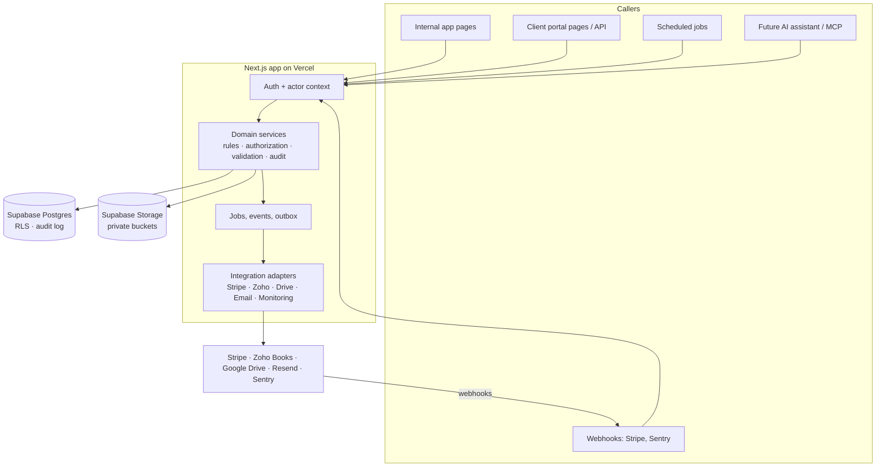

# 04 — Architecture

## In short

The app is **one Next.js application** (a "modular monolith"), organized by business area. Every business rule and permission check lives in a **server-side service layer**. The web pages, scheduled jobs, webhooks, client portal and future AI assistant all go through the same services, so none of them can bypass the rules. Supabase provides the database, logins and file storage; its row-level security is a second safety net, not the only one.

## 1. System diagram



## 2. Layers and folders [REC]

```
src/
  app/                    # routes only: pages, layouts, route handlers (thin)
    (internal)/           # owner/contractor app, admin layout guard
    (portal)/             # future client portal, client layout guard
    api/                  # webhooks, job tick, portal API, MCP
  domains/                # one folder per business area
    clients/  sales/  projects/  care/  requests/  tasks/
    money/  websites/  documents/  reports/  automation/  admin/
      service.ts          # the only entry point: functions taking (actor, input)
      rules.ts            # pure business rules (no I/O) → unit-tested
      repo.ts             # database access for this domain
      schemas.ts          # zod input/output schemas
  platform/
    auth/                 # actor context, requireRole, MFA check
    audit/                # writeAudit(actor, entity, before, after)
    calendar/             # business-day maths (one implementation)
    jobs/                 # job runner, idempotency, retries
    integrations/         # stripe/, zoho/, drive/, email/, monitoring/
    db/                   # Supabase clients (server-only), generated types
  ui/                     # design system: primitives, forms, tables, shell
supabase/
  migrations/             # numbered, applied only by the Supabase CLI
  tests/                  # RLS / policy tests
```

**Rules of the road:**
1. Pages and route handlers never touch the database directly. They call `domains/*/service.ts`.
2. Every service function receives an **actor** (owner, contractor, client, system job, integration, AI) and checks permission first.
3. Pure rules (MRR, business days, cycle windows, gates) live in `rules.ts` with unit tests. They have exactly one implementation.
4. The service-role database key exists only in `platform/db` (marked `server-only`). It is used for jobs, webhooks and the portal, always with an explicit actor and scoping.
5. Every write that matters calls `writeAudit` in the same transaction (via a Postgres function) or immediately after it.

## 3. Authentication, roles and permissions

| Role | v1 | Can do |
|---|---|---|
| **owner** | Active | Everything. Required for approvals, money, settings, user management. |
| **contractor** | Designed, off | Only assigned projects and tasks; no money, no settings, no client billing; time-limited access (SOP7 §5, SOP8 1.5) |
| **client** | Existing portal users | Only their own client's records marked client-visible; never internal notes or other clients (SOP8 4.1) |
| **system** | Jobs and webhooks | Narrow, named permissions per job (e.g. "create task", "record payment event") |
| **ai** | Later | Read tools plus proposals; consequential actions become approval requests (SOP8 3.3) |

- **Login:** Supabase Auth, email and password plus **mandatory MFA (authenticator app) for owner and contractor** (SOP8 4.1). Supabase's MFA support on the current plan is [U]; verify in Phase 1. Clients sign in with an email magic link, as today. Public sign-ups stay **off**; accounts are created by invitation only.
- **Guards:** the `(internal)` layout requires owner/contractor plus MFA; the `(portal)` layout requires client. Route handlers call `requireActor()`. No header-based shortcuts.
- **Database (RLS) strategy [REC]:**
  - The internal app reads through the server with the user's session, so RLS applies as a second line of defence.
  - Policies: `owner_all` on every table. `contractor_*` policies join on `assignments`. `client_select` only on portal-safe **views** that expose client-visible columns (this closes the old S6 column leak).
  - The `anon` role has no table grants (already true since 2026-11-04).
  - A CI check rejects any policy with `USING (true)` or no role restriction.
- **Sessions:** short-lived access tokens with refresh (Supabase default) and sign-out everywhere on role change. Login is rate-limited.

## 4. Integrations

| Integration | Authoritative for | Method | Sync | Failure handling | Phase |
|---|---|---|---|---|---|
| **Stripe** | Payments, invoices, subscriptions | API key (restricted where possible) + signed webhooks | Webhook events stored in `integration_events` (unique on event ID), plus a nightly reconciliation job | Retry with backoff; failed events visible in Automations; panels show "last synced" | Read: P3 (from the existing tables). Webhook cutover: P6 |
| **Zoho Books** | Accounting, expenses, receivables, statements | OAuth (scopes [U]) | Scheduled read-only pulls; never writes in v1 | "Unavailable" label when stale or failed | P6 |
| **Google Drive** | Finalized long-term documents | OAuth / service account (choice [U]) | Store file ID + link; verify the transfer before removing the app copy (SOP8 2.2) | Upload retried; the app copy is kept until verified | P6 |
| **Email (Resend)** | Outbound mail only | API key | Outbox table → sender job with idempotency key | Bounce handling [U]; failures surface in Automations | P4/P6 |
| **Monitoring** (own checkers + Sentry) | Site status and incidents | Own HTTP/TLS/RDAP checks; Sentry signed webhook | Store **state changes and incidents**, plus daily rollups (not unbounded raw checks) | Re-check before declaring "down" | P4 |
| **Search Console** | SEO metrics | OAuth [U] | Monthly pull for Professional/Growth | "Unavailable" if not connected | P7 |
| **MCP / AI clients** | Nothing (consumer) | Owner-scoped API key or OAuth | Calls services only | — | P7 |

No integration counts as working until it passes the staging acceptance checks (SOP8 1.3).

## 5. Jobs, events and notifications

- **One scheduler** [REC]: a single cron trigger calls `POST /api/jobs/tick` every few minutes. The tick reads due jobs from a `jobs` table and runs each idempotently (`job_runs` keyed by job + period). Recommended trigger: Vercel Cron if the current plan supports the needed frequency [U]; otherwise Supabase `pg_cron` + `pg_net` [U]. The old GitHub-Actions schedules and cron-job.org are retired at cutover (one owner per job).
- **Jobs:**
  - site checks
  - SSL and domain expiry
  - lead follow-ups and stale flags
  - care-cycle rollover (allowance reset, review task, report due)
  - delinquency ladder tasks
  - Stripe reconciliation
  - Zoho pulls
  - report drafting
  - email outbox
  - retention cleanups
- **Retries:** bounded exponential backoff. After the final failure, the run is marked failed and the owner gets a notification. A manual "re-run" is available.
- **Notifications:** urgent items (site down, payment failed, failed job, webhook signature failures) go out immediately by push and in-app. Routine items go into the in-app list and a daily digest (SOP8 3.6). Every push also creates an in-app row.
- **Automation registry** (`automations` table): trigger, conditions, action, risk level (auto / approval), owner, retry policy, manual fallback (SOP8 1.6).

## 6. Documents and storage

- **Private** Supabase buckets only. The client-logo bucket can stay public, but SVG uploads are blocked.
- Size and type limits on every bucket, and sanitized file names.
- Downloads use short-lived signed URLs created by the server after a permission check.
- A `documents` table holds the metadata: owner record, kind, visibility (internal / client), version, retention class, Drive file ID once finalized.
- Finalized records (signed agreements, reports, handoff) move to Drive with a verified copy. The app keeps the reference.

## 7. Client portal (phased)

- **Approach [REC]:** build the portal inside this app under `(portal)`, using the same services, and retire the static marketing-site page once it matches. Until then, keep `/api/portal/*` compatible with `docs/PORTAL_API.md` from the old repo.
- **Phase 5a:** login, project status, outstanding client actions, structured requests, uploads.
- **Phase 5b:** feedback and revision rounds, approvals (written launch approval, change orders), care reports, allowance used.
- Email stays the fallback for every workflow until its portal version is live (SOP8 2.3).

## 8. AI assistant and MCP readiness

- AI tools are thin wrappers over the **same service functions**, running as an `ai` actor on behalf of the owner. There is no raw SQL and no service-role access.
- **Read tools first:** list and get for clients, projects, tasks, requests and care obligations, the business overview, and incidents. Each answer cites its sources and freshness (SOP8 3.4).
- **Action tools create approval requests** (preview, target, consequence) that the owner approves in the app (SOP8 3.3). Prices, money, legal matters, permissions and external messages are never executed directly.
- Client files, emails and website content are treated as untrusted data, never as instructions.
- The redaction pattern of the existing MCP server is reused.

## 9. Environments and libraries

| Environment | Database | Stripe | Data |
|---|---|---|---|
| Local | Supabase local (CLI) | test mode | made-up |
| Staging | **separate Supabase project** | test mode | made-up |
| Production | the existing Supabase project | live | real only |

Libraries [REC], each justified:
- **Next.js (App Router), TypeScript strict, Tailwind and shadcn/ui:** ported from the old app.
- **zod:** input validation.
- **TanStack Query:** client caching, already used.
- **Supabase CLI:** migrations and generated types.
- **Vitest:** rules and services tests.
- **Playwright:** end-to-end tests.
- **Stripe SDK:** pinned API version.
- **date-fns-tz** or the built-in `Intl`: business-day and time-zone maths.

Everything else needs a reason before it's added.
