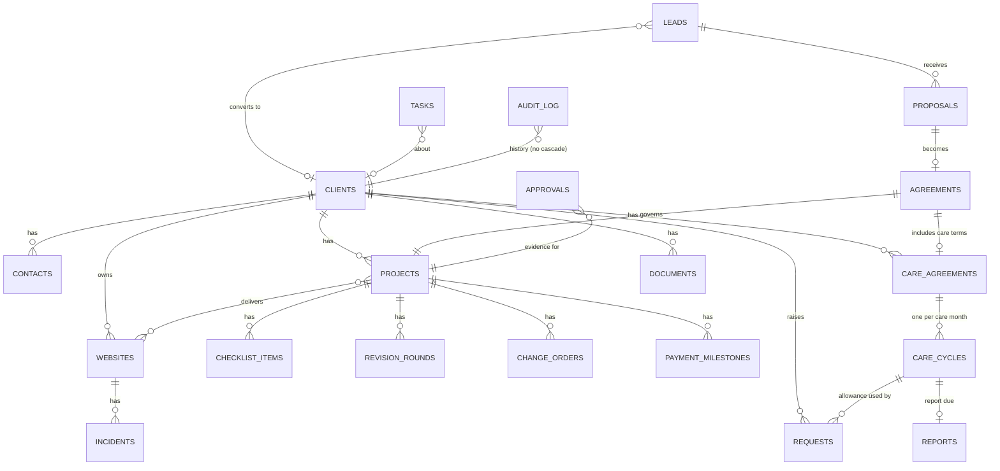

# 05 — Data Model

## In short

We keep the existing database and **add to it**. While the old app is still running, every change is **additive**: new tables, new nullable columns, views, and triggers that keep old and new fields in step. Nothing the old app relies on is removed or renamed until the old screen that uses it has been retired. Every record hangs off one canonical **client**. Prices and entitlements are **snapshotted** onto agreements, so later catalog changes never rewrite history.

The baseline is the live schema captured on 2026-11-04 (see 01 §2). It is **not** `supabase/schema.sql` from the old repo.

## 1. Entity relationship overview

## 2. Tables

**Legend:** **Keep** = unchanged · **Extend** = additive columns · **New** = new table · **Retire later** = dropped only after the old app is gone.

### Clients and contacts

| Table | Action | Purpose and key fields | Notes |
|---|---|---|---|
| `clients` | Extend | Canonical client. Add: `legal_name`, `acquisition_source`, `source_detail`, `lead_id`, `health_note`. Keep `stripe_customer_id` (also mirrored in `external_refs`). | Clients can now be created without Stripe (SOP2 §1). Status values stay for the old app; the new app derives operational status from agreements and billing state. |
| `contacts` | New | `client_id`, name, email, phone, role, `is_primary`, `portal_user_id` | Replaces `client_emails` and `client_phones` (both empty). Backfill from `clients.contact_name/email/phone`. |
| `accounts` | Retire later | Hidden grouping | No SOP need |

### Sales

| Table | Action | Purpose and key fields |
|---|---|---|
| `leads` | Extend | Add: `stage` (new_lead / in_discussion / proposal_sent / won / lost), `kind` (inbound / outbound), `service_interest`, `budget`, `timeline`, `priority` (high / medium / low), `owner_id`, `next_action`, `next_action_on`, `last_engaged_at`, `lost_reason` (price / timing / competitor / unresponsive / not_fit / other), `fit_need … fit_recurring` (0–5 or null), `client_id`, `campaign`. A trigger keeps old `status` and new `stage` in step until the old leads page is retired. |
| `lead_activities` | New | `lead_id`, kind (email / call / meeting / note / outreach), direction, `occurred_at`, summary. Engagement updates `leads.last_engaged_at`. |
| `proposals` | New | `lead_id`, `client_id`, scope, deliverables, `price_snapshot` (jsonb of catalog lines), `estimate_hours`, `estimate_direct_costs`, `discount_reason`, status (draft / sent / accepted / declined / superseded), `sent_at`. No expiry (SOP2 §5). |

### Agreements, projects and delivery

| Table | Action | Purpose and key fields |
|---|---|---|
| `agreements` | New | `client_id`, `proposal_id`, `signed_at`, `signer_name`, `signature_evidence` (provider ref or document), `project_terms` (jsonb snapshot: scope, `revision_rounds_included`, price, deposit %), `care_terms` (jsonb snapshot or null), `exceptions`, `document_id` |
| `projects` | Extend | Add: `agreement_id`, `stage` (onboarding / in_progress / client_review / launch / completed), `deposit_status`, `final_payment_status`, `assets_requested_at`, `assets_due_on`, `assets_ready_at`, `on_hold_since`, `hold_reason`, `revision_rounds_included`, `estimated_hours`, `actual_hours`, `launched_at` (exists), `completed_at`, `warranty_ends_on`. **`UNIQUE(client_id)` stays until the old project screens are retired**; then it's dropped so a client can have several projects (SOP8 1.4). |
| `checklist_templates` / `checklist_items` | New | Template (onboarding, QA, launch, post-launch, monthly review) → items per project or care cycle: label, `required`, `done_at`, `done_by`, `notes`. Seeded from the old repo's `WEBSITE_DEV_CHECKLIST.md`, subject to owner review. |
| `revision_rounds` | New | `project_id`, `number`, `opened_at`, `closed_at`, feedback list (link to requests or items) |
| `change_orders` | New | `project_id`, scope, `price`, `schedule_impact`, status (draft / sent / approved / declined), `approval_id` |
| `payment_milestones` | New | `project_id`, kind (deposit / final / other), amount, due date, status (pending / invoiced / paid / waived), `external_ref_id` (Stripe or Zoho invoice), `paid_confirmed_at` |
| `approvals` | New | Generic evidence: `subject_type` / `subject_id` (launch, change order, report, external message, AI action), `approver` (name / email or user), `channel` (email / portal / in-app), `evidence_document_id` or quoted text, `approved_at`. Append-only. |

### Websites and monitoring

| Table | Action | Purpose and key fields |
|---|---|---|
| `websites` | New | `client_id`, url, label, hosting provider, DNS/domain owner, backup method, restore notes, migration method, `monitoring_enabled`. Backfill from `projects.production_url` and `client_websites`. |
| `website_services` | New (replaces `project_services`) | Provider, account label, who owns it, notes. **No secrets.** |
| `site_monitors`, `site_monitor_checks`, `site_visual_checks`, `site_issues` | Keep → later re-key by `website_id` | `site_monitor_checks` rolls up to daily aggregates after 90 days [REC] |
| `incidents` | New | `website_id`, kind (down / ssl / domain / error / performance), severity, `opened_at`, `resolved_at`, `task_id`. Stores state changes, not every check. |

### Care

| Table | Action | Purpose and key fields |
|---|---|---|
| `care_plan_templates` | New | Catalog defaults: Essential $35 / 2 updates / 2 business days; Professional $49 / 3 / 1; Growth $99 / 5 / 1 with priority. Included services. |
| `care_agreements` | New | `client_id`, `template_id`, **effective terms snapshot** (price, updates per cycle, response target, included services), `anniversary_day`, `starts_on`, status (active / suspended / paused / cancelled), `billing_state` (current / grace / overdue / suspended / billing_paused), `cancel_requested_at`, `cancel_reason`, `ends_on`, `stripe_subscription_ref` |
| `care_cycles` | New | One per agreement per care month: `period_start`, `period_end`, `updates_included`, `updates_used` (derived), `review_task_id`, `report_due_on` (period end + 5 business days), `report_id`. UNIQUE(agreement, period_start). |
| `care_price_changes` | New | `agreement_id`, old price, new price, `notice_sent_at`, `effective_on` (≥ notice + 60 days, SOP1 §3) |
| `maintenance_events` | New | `website_id`, `occurred_at`, kind (check / alert / fix / update), summary, outcome, follow-up |
| `checkins` | New | Quarterly: `client_id`, `held_on`, satisfaction answer, notes, follow-up task |

### Requests and tasks

| Table | Action | Purpose and key fields |
|---|---|---|
| `requests` | Extend | Add: `type` (maintenance / warranty / included_update / billable_change / project_feedback), `severity` (critical / high / normal / low), `website_id`, `project_id`, `care_cycle_id`, `channel` (portal / email / phone / internal), `acknowledged_at`, `client_status` (derived, simple). Keep `display_id` and continue numbering. |
| `request_comments` | Extend | Add `visibility` (internal / client), defaulting to internal for the owner. Replaces the interim "author = client" rule. |
| `internal_work_items` → tasks | Extend now, rename later | Add: `related_type` / `related_id`, `task_type` (sales / project / care / finance / marketing / compliance / incident / internal), `assignee_id`, `source_key` (UNIQUE, for idempotent auto-created tasks), `recurrence`, `blocked_by`. Becomes `tasks` when the old Work page is retired. |

### Money and integrations

| Table | Action | Purpose and key fields |
|---|---|---|
| `revenue_events` | Extend | Add `period_start` / `period_end` (subscription invoices), `stripe_subscription_id`, `refunded_amount`, `livemode`. History is kept, including rows with no client. |
| `integration_events` | New | `provider`, `event_id` UNIQUE(provider, event_id), type, `received_at`, `processed_at`, status, error. This is the webhook dedupe ledger. |
| `external_refs` | New | `entity_type` / `entity_id` ↔ `provider` / `external_id` / `url`, `last_synced_at`. UNIQUE(provider, external_id). |
| `sync_status` | New | Per integration: last success, last error, freshness threshold |
| `expenses`, `subscriptions` | Freeze | Read-only in v2. Zoho is the expense source [OPEN] (see 09). |

### Platform

| Table | Action | Purpose and key fields |
|---|---|---|
| `audit_log` | New | `occurred_at`, `actor_type`, `actor_id`, `action`, `entity_type`, `entity_id`, `client_id` (no FK cascade), `before`, `after` (minimized), `approval_id`, `request_ip`. **Insert-only** (no update or delete grants). Replaces `activity_log` for new events; the old rows are kept. |
| `jobs`, `job_runs` | New | Job definitions and runs, with `idempotency_key` UNIQUE, status, attempts, error |
| `automations` | New | Registry (SOP8 1.6) |
| `notifications` | Extend | Add `user_id`, `severity`, `link`, `digest_sent_at` |
| `email_outbox` | New | To, template, payload, `idempotency_key`, `approval_id` (required for non-standing messages), status |
| `documents` | Extend `client_documents` | Add `related_type` / `related_id`, `visibility`, `version`, `retention_class`, `drive_file_id`, `finalized_at` |
| `business_calendar` | New | Time zone, working days, holidays [OPEN] |
| `user_roles` / `assignments` | New | Owner, contractor, client roles; contractor assignments with expiry |
| `compliance_items`, `disputes` | New (P7) | SOP6 registers |
| `security_findings` | Unknown origin | Keep untouched until the owner decides (09) |

## 3. Keys, constraints and history

- UUID primary keys throughout. Existing IDs are **never** changed: they appear in storage paths, portal links and auth links.
- Foreign keys are explicit. **No `ON DELETE CASCADE` from clients to history tables.** Clients are archived, never deleted.
- Idempotency comes from unique keys: `integration_events(provider, event_id)`, `job_runs.idempotency_key`, `internal_work_items.source_key`, `care_cycles(agreement, period_start)`, `reports(client_id, period_month)` (existing).
- Historical prices live in snapshots (`proposals.price_snapshot`, `agreements.project_terms` / `care_terms`, `care_agreements` terms). The catalog can change freely.
- Status columns use CHECK constraints. Allowed transitions are enforced in services and tested (06).

## 4. Data carried over

| Data | Plan |
|---|---|
| 13 clients | Kept in place. Contacts backfilled. The owner confirms each client's care tier and actual price → `care_agreements` (09). |
| 11 projects | Kept. Stage set by the owner in a one-time review (default: launched sites → completed). |
| 10 leads | Kept. `status` → `stage` mapping per 09 (recommended: interested → new_lead, contacted → in_discussion, quoted → proposal_sent). |
| 10 internal work items | Kept; become tasks |
| 64 revenue events, 28 reports, 3 requests, monitoring history | Kept as is |
| Request numbering | Continue `LUM-` numbering; reset the sequence to just above the highest real number (owner-approved migration) |
| Storage (17 files) | Kept at the same paths; `documents` rows link them |

Every migration:
- is numbered and applied by the Supabase CLI,
- is tested on staging first,
- has a backup and a written rollback or recovery note (SOP8 5.4),
- is applied to production only with the owner's approval for that specific migration.

The first migration (`0000_baseline`) records today's live schema exactly, so nothing changes when it's applied.
