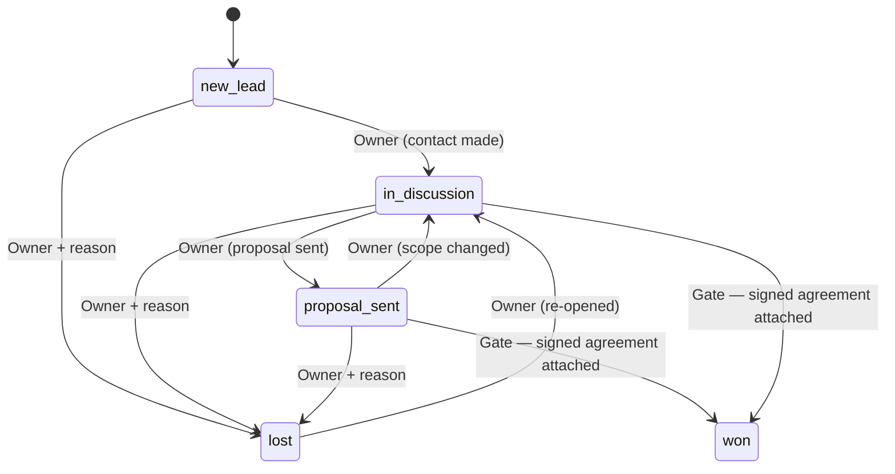
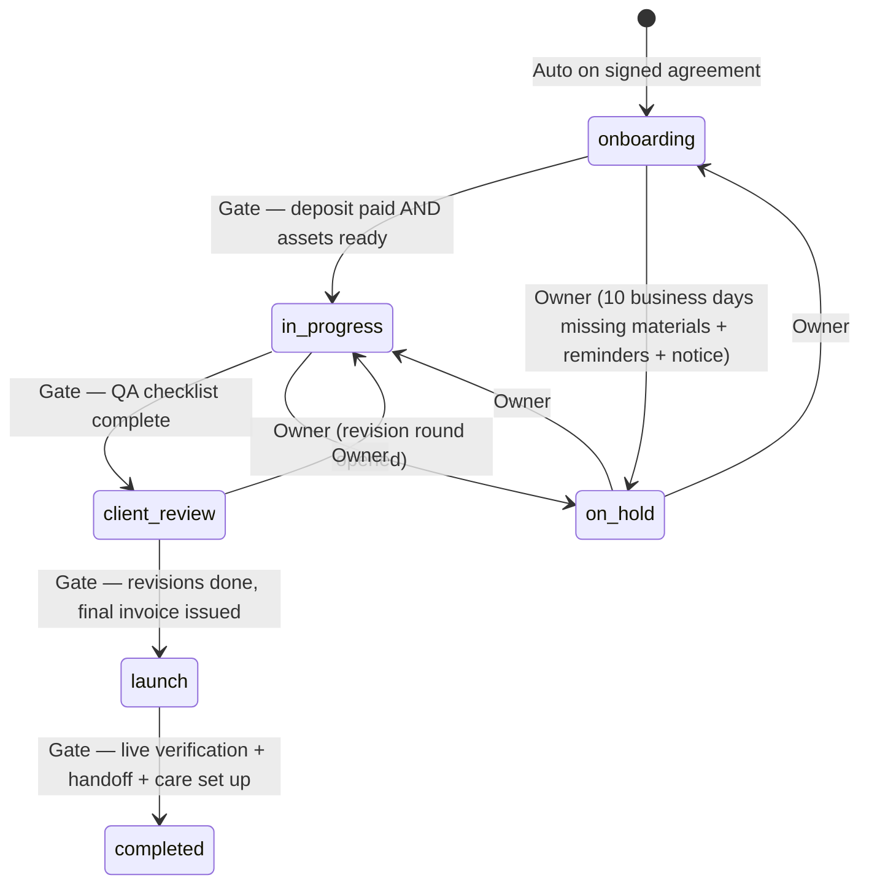

# 06 — Business Rules and Workflows

## In short

This document turns the SOPs into exact rules the app enforces. Each transition is labelled as **Auto** (the system does it), **Owner** (the owner does it), **Client** (the client does it), **Approval** (needs recorded approval), or **Gate** (refused until prerequisites are met). Every transition writes an audit entry.

## 1. Business days and time

- **One implementation** in `platform/calendar`, used everywhere.
- **Default [REC]:** Monday to Friday, time zone `America/New_York` (Georgia), plus a holiday list kept in Settings. The holiday list is [OPEN].
- "Within N business days after date D" means D plus N business days, ending at the close of that day.
- Calendar-day rules (30-day stale lead, 60-day price notice, payment ladder days, 30-day warranty) use **calendar days**, as the SOPs specify.
- Dates are stored as UTC timestamps or plain dates; they're shown in the business time zone.

## 2. Lead lifecycle (SOP2)

- **On create:** a reply-due task for inbound leads (1 business day).
- **Follow-ups:** when an outreach or proposal is logged without a reply, the app creates tasks at +2, +5 and +10 business days.
  - `source_key = lead:{id}:followup:{sequence}:{n}`, so re-running never duplicates them.
  - A logged reply cancels the open follow-ups in that sequence.
  - The owner decides what happens next.
- **Stale:** `last_engaged_at` older than 30 calendar days → "stale" flag and a weekly-review item. Never auto-closed or auto-lost.
- **Won (Gate):** requires an `agreement` with `signed_at`. In one transaction, the app:
  1. creates or links the canonical client, copying the acquisition source,
  2. creates the project (Onboarding, deposit pending),
  3. creates a deposit milestone (50% by default, from the agreement terms),
  4. creates the onboarding tasks.

  Won is **not** revenue.
- No external message is ever sent automatically from Sales. AI drafts need approval.

## 3. Project lifecycle (SOP3)

| Gate | Requires | Notes |
|---|---|---|
| Start production (→ in_progress) | Deposit milestone `paid` with an external reference **and** `assets_ready_at` set | The workspace exists before this; work just can't start (SOP3 §2) |
| Share preview (→ client_review) | All required QA checklist items done | Unresolved items must be recorded, not skipped |
| Revision round N | N ≤ `revision_rounds_included`; otherwise an **approved change order** | One round = one consolidated feedback list |
| Out-of-scope work | Change order `approved` with approval evidence (approver, channel, quote) | SOP3 §5, SOP6 2.4 |
| **Publish launch** | (1) written client approval recorded; (2) final payment milestone `paid`; (3) launch checklist complete | **Owner-initiated only. Never automated from a payment or approval event.** Each missing item is named in the error. This is a release-blocking test. |
| Completed | Post-launch checklist complete; handoff recorded; care agreement active or explicitly "no care"; access clean-up confirmed | Sets `warranty_ends_on = launched_at + 30 calendar days` |

- **Assets:** `assets_due_on = welcome/intake sent + 5 business days`. Reminder tasks at due and at due + 3 business days. At +10 business days with reminders sent, a task suggests a hold. The hold itself is Owner-initiated.
- **Welcome email:** queued once when (signed AND deposit paid). It is sent automatically **only if** the owner confirms it as a standing approval [OPEN]; otherwise it's a draft for approval.
- **Late project invoice:** tasks on day 3 (reminder) and day 7 (follow-up; may pause with written notice). Pausing is Owner-initiated.

## 4. Care: cycles, allowance, requests (SOP1 §3, SOP4)

- **Care month** = from the anniversary day to the day before the next anniversary. For the 29th–31st in shorter months, use the last day of the month [REC].
- **At cycle start (Auto, idempotent per agreement + period):**
  1. create the `care_cycle` with `updates_included` from the agreement terms (not the catalog),
  2. create the monthly review task with its checklist,
  3. set `report_due_on` (see §5),
  4. create the quarterly check-in task every third cycle [REC].
- **Unused updates don't roll over:** each cycle counts only its own requests.
- **Request handling:**
  1. Log it (the owner enters portal or email requests).
  2. Classify it: maintenance / warranty / included_update / billable_change.
  3. Severity: critical (outage, broken critical function) > high (significant performance or usability) > normal > low (cosmetic).
  4. Queue order: severity → care tier priority (Growth first within the same severity) → received time.
  5. Acknowledgment target: from the agreement terms, in business days. It's shown as an *acknowledgment* target, never a fix guarantee.
  6. `included_update` consumes 1 allowance (a small group of related edits counts as one, at the owner's judgment). When `updates_used = updates_included`, new included updates are blocked and the app offers "quote as billable change" instead (Gate).
  7. `warranty` is allowed only while today ≤ `warranty_ends_on` for that project, and never consumes the allowance.
  8. `billable_change` needs a quote and approval before work starts.
  9. Significant or sensitive changes need explicit client approval before publishing (SOP4 §3).
- **Client-visible request status [DECIDED]:**
  - Submitted (new),
  - In review (in_review),
  - In progress (in_progress),
  - Waiting on you (waiting_on_client),
  - Completed.

  Internal notes are never shown to clients.

## 5. Monthly reports (SOP4 §5)

- `report_due_on` = cycle end (the anniversary) + 5 business days.
- Essential gets a brief service summary; Professional and Growth get a full report.
- Flow: **Auto** creates the draft from stored data only (maintenance, requests, monitoring, analytics where connected). Missing data is labelled "unavailable". Then **Owner** reviews, edits and approves (an approval record is created). Then **Auto** sends the approved email (summary + portal link [DECIDED]) and logs delivery.
- Nothing is ever sent without approval. A report that's overdue and unapproved raises a high-priority task.

## 6. Care late-payment ladder (SOP1 §5, SOP3 §9, SOP4 §7)

Day 0 = renewal (anniversary) date. Days are calendar days.

| Day | Billing state | What happens | Type |
|---|---|---|---|
| −5 | current | Invoice or payment link sent by Stripe (or a renewal notice for autopay) | Auto (Stripe) [OPEN: Stripe-sent emails as standing approval] |
| 0 | current → grace if unpaid | Check payment | Auto |
| +3 | grace | Task: friendly reminder (draft) | Auto task; sending is Approval |
| +7 | overdue | Grace ends; task: formal overdue reminder | Auto task; sending is Approval |
| +14 | overdue | Task: care services **may** be suspended with notice; written deactivation warning (≥ 14 days' notice) | Auto task; suspension is Owner + evidence |
| +28 | overdue / suspended | **Earliest** website deactivation, only if the warning was sent ≥ 14 days earlier and the agreement and law permit | Owner only. **Never automatic.** |
| +30 | billing_paused | Task: pause future billing and services; relationship continues | Owner (Stripe pause) |
| Paid | → current | Verify the overdue balance is cleared; restore eligible services; no reactivation fee | Auto detection; restore is Owner |

Suspending care services and taking a site offline are **separate actions** with separate records.

## 7. Money definitions [DECIDED + REC]

All figures come from Stripe-derived data (Zoho later), showing a source and a "last synced" time. If data is stale or missing, the figure is shown as unavailable, never computed from guesses.

| Figure | Definition |
|---|---|
| **Collected MRR** [DECIDED] | Sum of the monthly care fees of active care agreements whose invoice **for the current billing period is paid** |
| Scheduled MRR | Active agreements whose current-period invoice isn't due yet |
| In grace | Current-period invoice unpaid, 0–7 days past due |
| Overdue | More than 7 days past due |
| Paused / suspended | Agreements in billing_paused or suspended. Never part of MRR. |
| Collected this month | Sum of paid payments with `paid_at` in the month, minus refunds |
| Outstanding | Open, unpaid invoices (Stripe; Zoho later), each listed |
| Pipeline value | Sum of open lead or proposal values. Labelled "not revenue". |

Until the new webhook stores invoice billing periods (P6), the current period is matched by `paid_at` within the care cycle window [REC], and the panel says so.

## 8. Cancellation and archive

- **Care cancellation (Owner):** record the written request, reason and end date. Stop future billing (Stripe). Create the handoff checklist. Status → cancelled at the end date. Data is kept.
- **Archive a client (Owner):** hidden from active lists and jobs; all history kept. A Stripe "customer deleted" event archives (already live since 2026-11-04).
- Routine actions never hard-delete anything. Deletion for retention reasons is a separate, logged, owner-approved process.

## 9. Monitoring incidents (SOP4 §2, SOP6 3.4)

- A check failure triggers a re-check after about 2 minutes. Only a confirmed failure opens an `incident` and alerts the owner immediately.
- Recovery closes the incident and records its duration. Duplicates are suppressed while the incident is open.
- SSL and domain expiry: tasks at 30 / 14 / 7 / 3 / 1 days. Each milestone is created once (idempotency key).
- "Under 3 s" is a **performance** signal, not a security check. It's reported separately.
- No uptime guarantees are shown or implied.
